# Word of the Day

Native apps showing Merriam-Webster's Word of the Day from
https://www.merriam-webster.com/wotd/feed/rss2. Every word is archived on the
device, so the full history stays available offline.

- **Android** (Kotlin, Compose): the full app, described below
- **iOS** (SwiftUI, iOS 16+): Today and Saved tabs, with the same local archive
- **Pebble** (C watchapp + PebbleKit JS): rate words from your wrist; ratings
  sync with the Android app

## Android

  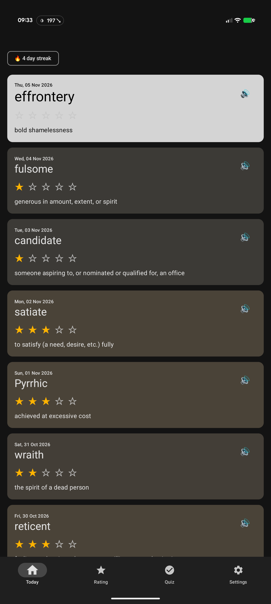
  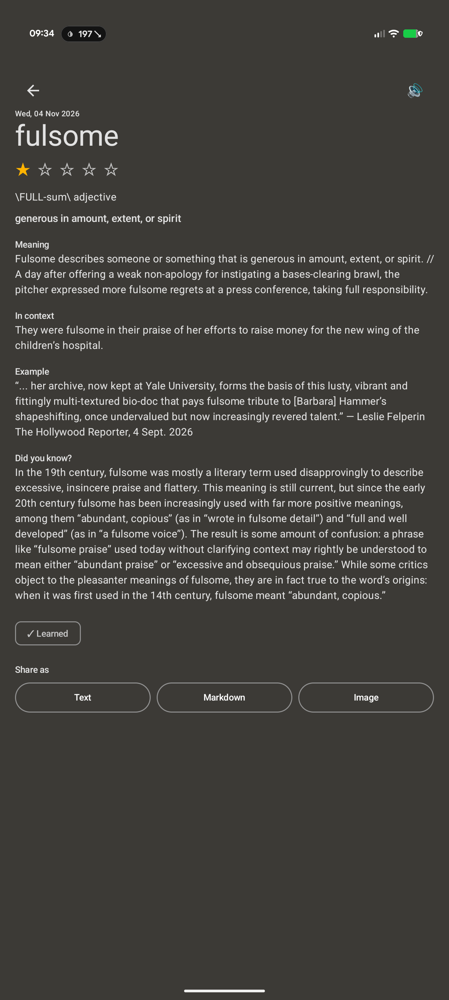
  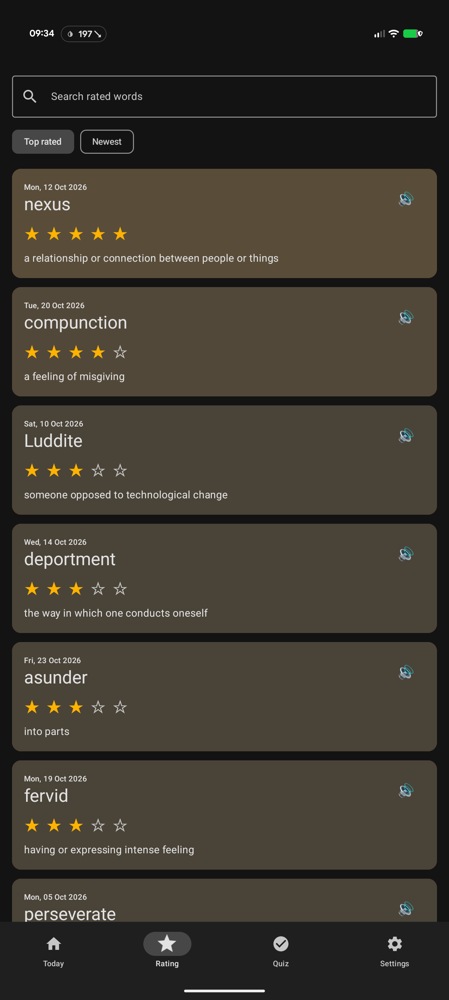
  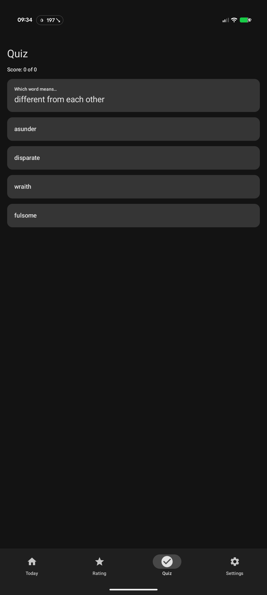
  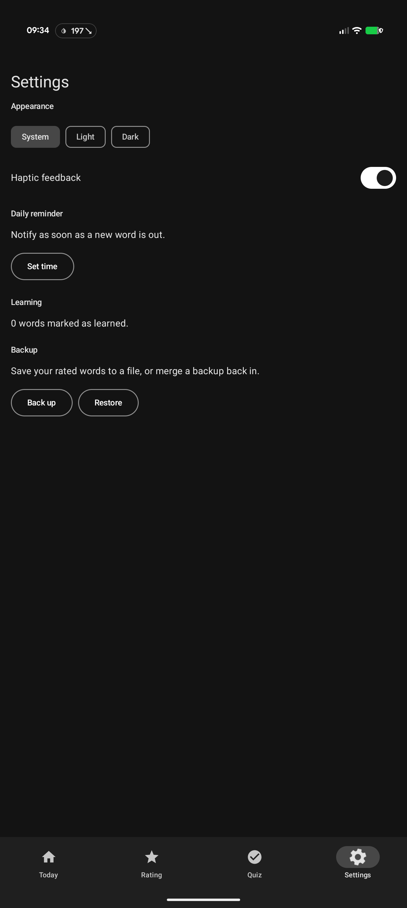

- **Today**: the newest word as a highlighted card above the archive, with a
  day streak, pull to refresh and a skeleton while loading. Tap a card to open
  the full entry, with meaning, usage, examples and "Did you know?".
- **Rating**: rate words from one to five stars, then search them or sort by
  top rated or newest. Swipe a word away to remove its rating, with undo.
- **Quiz**: "which word means…" questions, weighted towards the words you miss.
  Mark words as learned to stop seeing them.
- **Settings**: theme (system, light or dark), haptics, a daily reminder time,
  and backup and restore of your ratings.
- **Share** a word as text, Markdown or an image card.
- **Widget** for the home screen, with its own theme, size, opacity and tap
  action.
- Pronunciation audio on every card.

### Animations

  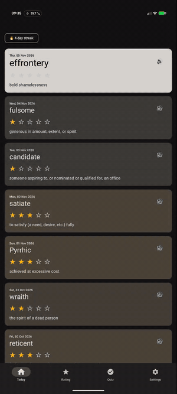
  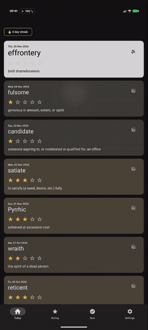
  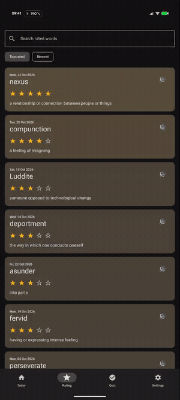

Stars pop as you rate, with confetti at five. A card expands into its detail
screen and shrinks back. Swiping a rated word away collapses its row, and
Undo slides it back in.

## Pebble

  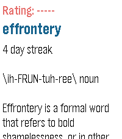
  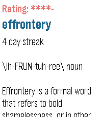
  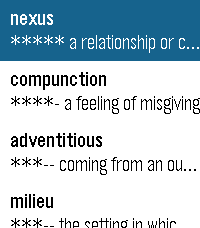

Today's word with its pronunciation and meaning, plus your day streak. Press
Select to cycle the rating from zero to five stars, or long-press it for your
saved words, sorted by rating. Ratings sync with the Android app, and colour
watches get an orange rating and a blue word. Screenshots are from a Pebble
Time 2 (emery).

## Build

- **Android**: `cd android && ./gradlew :app:assembleDebug`. For a release
  build, copy `android/keystore.properties.example` to `keystore.properties`
  and fill in your signing key; without it the release build is signed with the
  debug key.
- **iOS**: `cd ios && xcodegen && open WordOfTheDay.xcodeproj`
- **Pebble**: `cd pebble && pebble build && pebble install --emulator basalt`
  (see [pebble/README.md](pebble/README.md))
